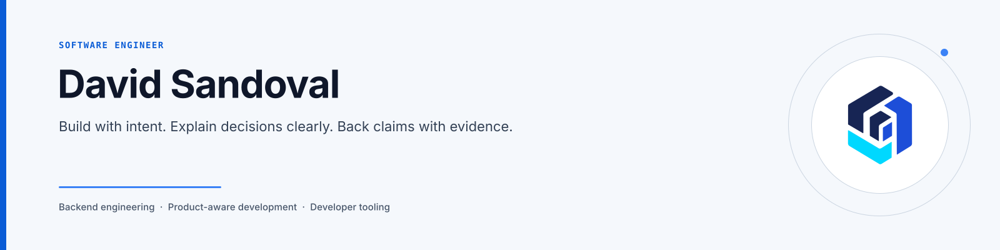

<picture>
  <source media="(max-width: 600px) and (prefers-color-scheme: dark)" srcset="./assets/brand/github-profile-header-mobile-dark.svg">
  <source media="(max-width: 600px) and (prefers-color-scheme: light)" srcset="./assets/brand/github-profile-header-mobile-light.svg">
  <source media="(max-width: 600px)" srcset="./assets/brand/github-profile-header-mobile-light.svg">
  <source media="(prefers-color-scheme: dark)" srcset="./assets/brand/github-profile-header-dark.svg">
  <source media="(prefers-color-scheme: light)" srcset="./assets/brand/github-profile-header-light.svg">
  
</picture>

**Software Engineer** based in Peru (`UTC-5`), working remotely on production fintech software since January 2026.

My day-to-day work is backend-oriented with **.NET and C#**, extending across **Angular and TypeScript** when features, contracts, or bugs cross the stack. What I enjoy most is the investigation behind a reliable fix: tracing assumptions, narrowing a failure to the right layer, making contracts explicit, and verifying that the behavior actually changed.

[Portfolio](https://sandovaldavid.com) · [Resume (PDF)](https://sandovaldavid.com/resume/david-sandoval-resume.pdf) · [Link Hub](https://hub.sandovaldavid.com) · [LinkedIn](https://www.linkedin.com/in/davidsandoval-s) · [hello@sandovaldavid.com](mailto:hello@sandovaldavid.com)

## Engineering in production

### Software Engineer · Atena (Fintech)

*Remote · January 2026 – Present*

Building and maintaining fintech software with **.NET/C#** and **Angular/TypeScript**. My work focuses on debugging behavior across layers, tightening authorization boundaries, coordinating contract changes between services, and validating fixes with tests, compiler feedback, and static analysis. Because the company codebase is private, I keep proprietary details sanitized and share only the engineering patterns I can discuss responsibly.

## Selected engineering work

| System | Scope & engineering focus | Verification & links |
| :--- | :--- | :--- |
| **[Kioku](https://github.com/sandovaldavid/kioku)** | Local-first **.NET MCP server** for preserving, retrieving, and updating structured knowledge in Obsidian vaults across AI-agent sessions. Maintained across MCP contracts, retrieval, security boundaries, testing, CI/release automation, and documentation. | [Repository](https://github.com/sandovaldavid/kioku) · [Docs](https://kioku.sandovaldavid.com) · [Releases](https://github.com/sandovaldavid/kioku/releases) |
| **[Yukidoke](https://sandovaldavid.com/projects/yukidoke)** | Private household finance platform with a modular **.NET API** and an **Angular** client. Currently in active V1 hardening and used as ongoing domain and architecture practice rather than presented as a public release. | [Case Study](https://sandovaldavid.com/projects/yukidoke) *(Private repo)* |
| **[OCI ARM Hunter](https://github.com/sandovaldavid/oci-arm-hunter)** | **Bash & OCI CLI** automation tool that retries Oracle Cloud ARM Always Free capacity, rotates Availability Domains, adds jitter between attempts, and supports unattended notifications—turning an operational bottleneck into a reproducible tool. | [Repository](https://github.com/sandovaldavid/oci-arm-hunter) · [Docs](https://oci.sandovaldavid.com) |

## How I approach engineering

- **Trace assumptions first:** Understand the assumption behind a bug before touching the fix.
- **Make contracts explicit:** Use compiler/type feedback, automated tests, and static analysis to surface hidden consumers and make changes safer to reason about.
- **Follow the evidence:** When new evidence contradicts an initial hypothesis, update the conclusion instead of forcing the evidence to fit it.
- **Leave durable context:** Write down key decisions and trade-offs so the next investigation starts with clearer context.

## Tools I work with

**Backend & APIs**

 

**Frontend**

 

**Data**

  

**Tooling**

  

Tools evolve over time; the discipline I focus on compounding is engineering judgment: understanding constraints, making trade-offs explicit, and designing software that remains safe to change.

## Beyond the code

Outside of production work, I build open-source developer tools, write technical documentation, and explore software architecture across backend and web systems. Away from the keyboard, you'll usually find me around books, Japanese culture, music, or games.

## Contact

If you're reviewing my GitHub for a software engineering role or collaboration, my [portfolio](https://sandovaldavid.com) and [resume](https://sandovaldavid.com/resume/david-sandoval-resume.pdf) offer the complete picture. You can also reach me directly on [LinkedIn](https://www.linkedin.com/in/davidsandoval-s) or at [hello@sandovaldavid.com](mailto:hello@sandovaldavid.com).
